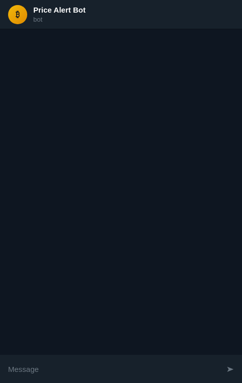

# Telegram Price Alert Bot

A small Telegram bot that watches Binance spot prices and messages you when a price crosses your level.

```
/add BTCUSDT > 70000
```

<p align="center"></p>
<p align="center"><sub>Demo with illustrative prices: the bot's replies are rendered from its own message functions.</sub></p>

## Features

- `/add SYMBOL > PRICE` or `/add SYMBOL < PRICE`: fires at or above / at or below the level, once, then removes itself
- `/list`, `/remove ID`, `/price SYMBOL`, `/help`
- Symbols are checked against Binance's live spot list, so a typo is refused at once
- **One request per check** for all watched symbols (`/api/v3/ticker/price?symbols=[...]`), well inside Binance's rate limits
- Public market data only: **no Binance API key, no account access**
- Alerts are stored in SQLite (`data/alerts.db`) and survive restarts
- Prices are handled as `Decimal` (no float rounding on levels like `0.00001234`)
- Each chat sees and removes only its own alerts; a per-chat limit stops abuse
- A network error or rate limit skips one tick; nothing is lost

## Quick start (Docker)

1. Create a bot with [@BotFather](https://t.me/BotFather) and copy its token.
2. Configure and run:

```bash
cp .env.example .env        # put your token in TELEGRAM_BOT_TOKEN
docker compose up -d --build
docker compose logs -f
```

3. Open your bot in Telegram and send `/start`.

## Run without Docker

```bash
python -m venv .venv && . .venv/bin/activate
pip install -r requirements.txt
export TELEGRAM_BOT_TOKEN=...   # or: set -a; . ./.env; set +a
python -m bot.main
```

## Configuration

| Variable | Default | Meaning |
|---|---|---|
| `TELEGRAM_BOT_TOKEN` | required | token from @BotFather |
| `CHECK_INTERVAL` | `15` | seconds between price checks |
| `MAX_ALERTS_PER_CHAT` | `20` | active alerts per chat |
| `BINANCE_BASE_URL` | `https://api.binance.com` | use `https://data-api.binance.vision` (market data only) if api.binance.com is blocked where you host |
| `DB_PATH` | `data/alerts.db` | SQLite file |

## How it works

```
Telegram ──commands──▶ handlers (bot/main.py) ──▶ SQLite (bot/store.py)
                                                      ▲
JobQueue every CHECK_INTERVAL s ──▶ Binance /ticker/price (one call, all symbols)
        └── alert hit? ──▶ send message ──▶ delete alert
```

| File | Role |
|---|---|
| `bot/alerts.py` | parsing `/add`, the trigger rule, message text (pure functions) |
| `bot/binance.py` | async Binance client (httpx) |
| `bot/store.py` | SQLite storage |
| `bot/main.py` | Telegram handlers and the periodic check |

## Tests

```bash
pip install -r requirements-dev.txt
python -m pytest -q
```

The tests cover parsing, the trigger rule, formatting, storage and per-chat ownership, plus the price-check job with a fake Telegram bot and a fake Binance client (fires once, removes the alert, survives a network error). They make no network calls.

## Ideas for extensions

Percentage moves (`/add BTCUSDT +5%`), repeating alerts with a cool-down, inline-keyboard buttons for `/list`, webhook mode, other exchanges.

## License

MIT
